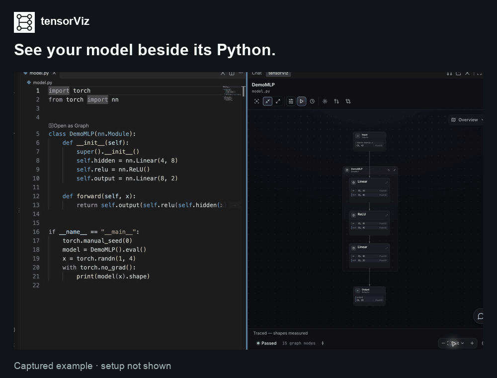

# tensorViz examples and support

**Understand the PyTorch model you are changing, inside VS Code.**

Open an `nn.Module` as a graph, expand nested modules, follow shapes from a captured
forward pass, and jump to the Python source. Use the graph alongside your code
review to understand architecture changes.

[Install from the VS Code Marketplace](https://marketplace.visualstudio.com/items?itemName=tensorviz.tensorviz-vscode)
· [Open VSX listing](https://open-vsx.org/extension/tensorviz/tensorviz-vscode)
· [Try recorded models in your browser](https://tensorviz.dev/explore/)
· [Setup guide](https://tensorviz.dev/install.html#first-graph)

This repository contains small, public examples and a place to ask questions or
report reproducible problems. It is **not the extension's source repository**.
The extension is free to install; its source repository is private.

*Recorded in tensorViz 0.1.10; setup not shown. Shapes describe this example input.*

## Try an example

| Exercise | What you will check |
| --- | --- |
| [Same interface, different computation](examples/model-review/README.md) | Review a ReLU-to-GELU edit and test what unchanged shapes do not guarantee. |
| [Fix a flatten-to-Linear shape mismatch](examples/shape-mismatch/README.md) | Reproduce `mat1 and mat2 shapes cannot be multiplied`, calculate the feature count, and preserve batch semantics. |

Both exercises run on CPU without installing tensorViz. To explore the first
one in the extension:

1. **Install tensorViz** in desktop VS Code **1.106 or newer**.
2. **Get this repository** using GitHub's **Code → Download ZIP**, or clone it.
   Open `examples/model-review` as your VS Code folder. Follow its
   [Python setup](examples/model-review/README.md#setup) and run `python verify.py`.
3. **Open `before.py`**, then click **Open as Graph** above `ReviewNet`.
   Select the environment you used in step 2. The included `tensorviz.toml`
   supplies a CPU input of shape `[1, 4]`. Expand the model and follow its
   `[1, 4] → [1, 8] → [1, 2]` flow.

No GPU, model download, API key, coding agent or analytics opt-in is required for
this exercise. First use may need the extension's service dependencies; tensorViz
asks before downloads or package changes. We do not promise a fixed first-run
setup time.

## The exercise: same interface, different computation

[`examples/model-review`](examples/model-review/README.md) contains a before and
after version of one small network. The change replaces ReLU with GELU and adds
LayerNorm. Both versions accept `[batch, 4]` and return `[batch, 2]`.

The included check uses the same controlled linear weights in both versions. It
asserts the shapes at module boundaries and demonstrates that unchanged shapes do
not imply unchanged numerical results. The weights are educational, not trained.

Explore both versions, find the new operation, then use the executable checks to
answer a separate question: what behavior did the change preserve?

## What a graph tells you

- Captured shapes describe the input and execution path that ran, not every
  possible input or branch.
- Source and architecture comparison helps review code. It does not execute both
  revisions or establish numerical correctness.
- A snapshot in the browser is an example to explore. To capture your own model,
  use tensorViz with your model's Python environment.

The [model-review guide](examples/model-review/README.md) explains the exercise,
expected results and the checks behind those boundaries.

## Compatibility

These instructions target **tensorViz 0.1.11**. Model capture supports Python
**3.10–3.14** with compatible PyTorch and model dependencies. The separate
tensorViz service requires Python **3.11+**. Expression-level source edits require
Python **3.11+**. Your Python 3.10 model environment can remain separate.

The published compatibility pass covers macOS Apple Silicon and Ubuntu x86_64;
it does not establish Windows, CUDA or every Python/PyTorch combination. The
example's exact local CPU test environment is recorded in
[validation notes](docs/validation.md). For current platform limits and Remote SSH
setup, use the [compatibility guide](https://tensorviz.dev/install.html#compatibility)
and [Remote SSH guide](https://tensorviz.dev/install.html#remote).

VS Code is the documented editor workflow. The extension is also available from
[Open VSX](https://open-vsx.org/extension/tensorviz/tensorviz-vscode); publisher
verification was still pending at the October 11, 2026 check. Registry availability
does not establish native Cursor or Windsurf capture compatibility.

## Questions, bugs and contributions

Use the repository's **Issues** tab for public questions and minimal bug reports.
Read [support instructions](docs/support.md) before sharing files or screenshots.
Do not post private code, checkpoints, credentials, proprietary model details or
analytics installation IDs. Existing Marketplace questions remain available in
[Marketplace Q&A](https://marketplace.visualstudio.com/items?itemName=tensorviz.tensorviz-vscode#qna).

Small, reproducible examples and clearer instructions are welcome. Explain what a
new example teaches, include a CPU check when possible, and document its limits.
There is no automated workflow in this repository; run the documented checks
locally before opening a pull request.

## License

The original example code and written documentation in this repository are
[MIT licensed](LICENSE). PyTorch is a separate dependency with its own license.
The included tensorViz logo identifies the project; the MIT license does not
grant trademark rights. The extension and its bundled dependencies retain their
own licenses. See [licenses and attribution](docs/licenses.md).
